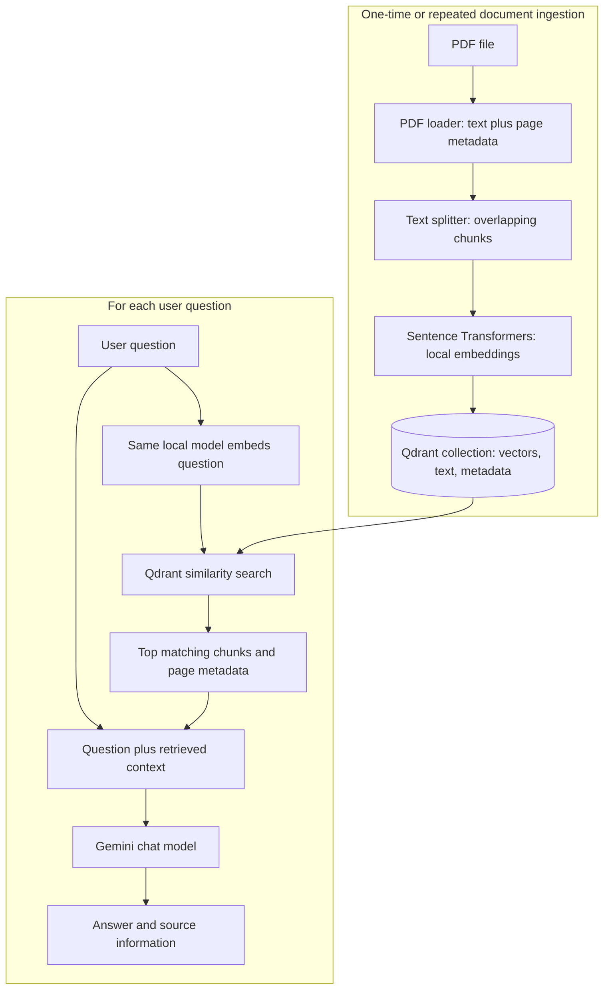

# PDF Question-Answering with RAG

A beginner-friendly learning project that lets you ask questions about a PDF. It uses a local embedding model to search document chunks, Qdrant to store them, and Gemini to write the final answer.

This README explains the idea and the current project workflow. It is not an agent project: the first goal is to understand document ingestion and retrieval before adding FastAPI, agents, or tools.

## What You Are Building

Imagine asking a librarian a question about a book. The librarian first finds the relevant pages, then uses those pages to answer. A RAG application follows the same pattern:

1. Read the PDF and extract its text and page metadata.
2. Split the text into smaller chunks.
3. Convert each chunk into a vector using an embedding model.
4. Save each vector and its original text and metadata in Qdrant.
5. Convert a user's question into a vector and search Qdrant for similar chunks.
6. Give the question and retrieved text to a chat model, which writes the answer.

RAG helps an LLM answer from your documents instead of relying only on what it learned during training. It does not guarantee a correct answer: if retrieval finds the wrong text, the LLM may still say it cannot answer.

## Architecture



### Who Does What?

| Part | Role in this project |
| --- | --- |
| PDF and `PyPDFLoader` | Extract page text and loader metadata such as PDF page index and page label. |
| `RecursiveCharacterTextSplitter` | Splits long page text into smaller overlapping chunks. |
| Hugging Face Hub | Hosts the selected model files. |
| Sentence Transformers | Downloads and runs `all-MiniLM-L6-v2` locally to create text embeddings. |
| LangChain Hugging Face integration | Gives the local model LangChain's standard embeddings interface. |
| Qdrant | Stores and searches vectors together with each chunk's text and payload metadata. |
| Gemini chat model | Reads the retrieved context and writes a natural-language answer. |

The embedding model and chat model have separate jobs. Embeddings find relevant text; Gemini writes the response. The local embedding model does not use the Gemini embedding API quota.

## Current Project Setup

The current scripts are configured to use:

- PDF: `materials/ncc_book.pdf`
- Embedding model: `sentence-transformers/all-MiniLM-L6-v2`
- Qdrant collection: `course_documents-2`
- Chat model: `gemini-3.5-flash-lite`
- Qdrant URL: `http://localhost:6333`
- Chunk size: 1,500 characters
- Chunk overlap: 300 characters
- Retrieval count: up to 8 chunks (`k=8`)

The embedding model normally produces 384-dimensional vectors. The same model and settings must be used when indexing chunks and embedding questions. Do not mix its vectors with vectors from a Gemini embedding model; they belong in different Qdrant collections.

### Folder Layout

```text
RAG/
  .env                    # Gemini API key; keep private
  .gitignore
  docker-compose.yml      # Qdrant service and persistent Docker volume
  ingest.py               # PDF loading, chunking, embedding, and Qdrant storage
  retrieval.py            # question embedding, similarity search, and Gemini answer
  requirements.txt
  materials/
    ncc_book.pdf
```

## Setup on Windows

### 1. Start Docker and Qdrant

Docker Desktop must be running. On Windows, Docker Desktop typically runs Linux containers through its WSL 2 backend, so Windows virtualization support and WSL 2 must be available.

Open PowerShell in the `RAG` directory:

```powershell
cd "C:\Users\Admin\Desktop\Gen ai course\RAG"
docker compose up -d
docker compose ps
```

Open the Qdrant dashboard at [http://localhost:6333/dashboard](http://localhost:6333/dashboard). The Compose file uses a named volume called `qdrant_storage` so data can persist when the container is stopped or recreated.

Useful container commands:

```powershell
docker compose stop vector-db
docker compose start vector-db
docker compose down
```

`docker compose down` removes the container but keeps the named volume. `docker compose down -v` also deletes the volume and all Qdrant data. Avoid `-v` unless you intentionally want to erase the database.

### 2. Create and Activate the Python Environment

If the project does not already have its own virtual environment:

```powershell
python -m venv .venv
.\.venv\Scripts\Activate.ps1
```

The PowerShell prompt should show `(.venv)`. Install the integrations used by the current scripts:

```powershell
python -m pip install langchain-community langchain-text-splitters langchain-qdrant qdrant-client langchain-google-genai langchain-huggingface sentence-transformers python-dotenv pypdf
```

The first installation of Sentence Transformers may take a while because it installs model-running dependencies such as PyTorch. On the first model use, Sentence Transformers also downloads the model files to the local Hugging Face cache. Later runs reuse that cached model.

### 3. Configure the Gemini API Key

Create a `.env` file in `RAG`:

```text
GEMINI_API_KEY=your-key-here
```

Keep the real key private. Do not paste it into the README or commit `.env` to source control. The retrieval script uses Gemini to generate answers. The current ingestion script also still checks for this key even though its active embedding model is local; that check is leftover and can be removed when simplifying ingestion.

## Run the Pipeline

### Step 1: Ingest the PDF

With Qdrant running and the RAG virtual environment active:

```powershell
python .\ingest.py
```

The script loads `materials/ncc_book.pdf`, splits page text into chunks, embeds those chunks locally, then stores the vectors and payloads in the `course_documents-2` collection.

The first run can take longer while the model downloads. Processing a large PDF on CPU also takes time. The current script does not print progress for each chunk, so a quiet terminal does not necessarily mean it is stuck.

The current collection has had interrupted ingestion attempts. Before relying on retrieval, verify in the Qdrant dashboard that the new collection contains the complete set of chunks. The source PDF has 364 pages; the exact chunk count depends on the current splitter settings and on which pages contain extractable text. If a run is interrupted and the collection exists only partially, use a fresh collection name for a clean ingestion run, or deliberately remove and recreate the incomplete collection. Do not erase the Docker volume to solve an indexing problem.

### Step 2: Ask a Question

```powershell
python .\retrieval.py
```

Type a question when prompted. Retrieval embeds the question locally, searches the same Qdrant collection, and passes the returned chunks to Gemini. The script currently requests up to 8 chunks.

Check the retrieved chunk text before deciding whether the chat model is at fault. If the returned chunks do not contain the answer, improve ingestion or retrieval first. If a chunk does contain the answer but Gemini misses it, then adjust the prompt or generation step.

## How the Important Concepts Work

### Pages, Chunks, and Metadata

A PDF loader usually returns one LangChain `Document` per page. Each document has:

- `page_content`: extracted text.
- `metadata`: information such as source filename, zero-based `page`, and `page_label`.

The splitter then divides long page text into chunks. With a chunk size of 1,500 and overlap of 300, nearby chunks repeat some text so a key sentence is less likely to be split without its surrounding context. Page metadata is copied to the chunks, allowing a retrieved chunk to be traced back to its PDF page.

Chunk size here is measured in characters, not tokens. Different files may need different loaders, but the general pattern stays the same: extract text and metadata, then split the text into chunks.

### PDF Page Versus Printed Book Page

There are multiple page-number concepts:

- `metadata.page` is zero-based. For example, `page: 313` means the 314th physical PDF page.
- `metadata.page_label` is the PDF's page label, often displayed as the page number in a PDF viewer.
- The printed number visible on the book page can be different from both.

In this NCC PDF, physical PDF page 314 has printed book page 307. The current ingestion stores the PDF loader's metadata; it does not yet extract the printed book page into a dedicated metadata field. The current retrieval output therefore can reliably identify the PDF page, but not always the printed book page. A future improvement is to extract printed page numbers during ingestion and store them as a field such as `printed_page` on every chunk.

### Embeddings and Similarity Search

An embedding model converts text into a numeric vector. Similarity search compares the question vector with stored chunk vectors and returns the nearest matches. It does not understand whether a match contains a complete answer. A table of contents entry like "Wild Life" may be semantically close to a question about wildlife, even when a later chapter contains the actual explanation.

`k=8` means retrieve up to eight nearest chunks. It is not a confidence threshold. A similarity score is a ranking signal, not a probability that the answer is correct. Inspect retrieved text and scores when tuning search.

### Payload Filters Versus Similarity Search

Qdrant filters restrict results using stored payload fields such as filename, page, or document ID. They are useful for requests like "search only this PDF" or "show points from PDF page 314." They do not replace semantic search for questions like "What role does wildlife play?"

In the Qdrant dashboard's Points tab, the payload filter accepts field/value filters. For the example payload, the nested page fields are `metadata.page` and `metadata.page_label`. PDF page 314 corresponds to `metadata.page:313` and often `metadata.page_label:314`. Filters only return points that were actually stored.

### Why Use LangChain?

LangChain provides common interfaces and integrations for loaders, splitters, embedding models, vector stores, and chat models. It lets the project connect Sentence Transformers, Qdrant, and Gemini with less provider-specific glue. It does not perform the embedding or vector search itself; it calls the selected model and database integrations.

A LangChain document loader can simplify PDF loading, but the current `PyPDFLoader` import comes from `langchain-community`, which now emits a deprecation warning because that package is being sunset. It still works in this project. A later cleanup can use `pypdf` directly and wrap each page in a LangChain `Document`.

## Troubleshooting

### Gemini Embedding Returns 429 `RESOURCE_EXHAUSTED`

This means the Gemini embedding API quota or request rate was exceeded. It is unrelated to Qdrant. The project originally used Google embeddings and reached a free-tier request limit. The active ingestion code now uses local Sentence Transformers, which avoids Gemini embedding requests. Make sure the active code constructs `HuggingFaceEmbeddings`, not `GoogleGenerativeAIEmbeddings`.

Gemini still handles answer generation in `retrieval.py`, so that separate API call still requires a valid key and may have its own quota.

### Gemini Returns 404 `Not Found` for an Embedding Model

A model name such as `sentence-transformers/all-MiniLM-L6-v2` is a Hugging Face model ID, not a Google model ID. Pass it to `HuggingFaceEmbeddings`. Passing it to `GoogleGenerativeAIEmbeddings` sends an invalid Google API request.

### `ModuleNotFoundError: qdrant_client`

Install the database client into the active project environment:

```powershell
python -m pip install qdrant-client
```

Then add `qdrant-client` to the project dependencies.

### `ModuleNotFoundError` for Hugging Face or Sentence Transformers

Install both packages in the RAG virtual environment:

```powershell
python -m pip install langchain-huggingface sentence-transformers
```

### Similarity Search Returns Only a Table of Contents Entry

The retrieval system may be matching a heading instead of the detailed explanation. Print the returned page content and inspect it before sending it to Gemini. Increase `k` only to inspect more candidates; more candidates do not automatically mean better results. Query with terms closer to the document's wording, and consider excluding table-of-contents pages or trying hybrid vector and keyword search after basic retrieval is working.

### Page 314 Is Missing in the Dashboard

The local PDF and splitter produce chunks for PDF page 314, but the Qdrant collection previously contained only 64 points. The current PDF and splitter settings produce many more chunks than that. This indicates ingestion was incomplete, not that the page number filter was wrong or that the chat model could not find the page. Re-run ingestion into a clean collection and verify the final point count before retrieval.

### `ValueError: too many values to unpack`

`similarity_search()` returns documents. `similarity_search_with_score()` returns `(document, score)` pairs. Use matching iteration:

```python
for document in vector_store.similarity_search(question, k=8):
    print(document.page_content)

for document, score in vector_store.similarity_search_with_score(question, k=8):
    print(score, document.page_content)
```

### Docker Cannot Start on Windows

Docker Desktop needs hardware virtualization. For the WSL 2 backend, Windows Subsystem for Linux and Virtual Machine Platform must also be enabled. A Python virtual environment does not provide or replace virtualization.

## Suggested Learning Order

1. Print extracted PDF pages and check their metadata.
2. Print chunks and confirm the page metadata survived splitting.
3. Embed one short text locally and inspect the vector length.
4. Store a small set of chunks and verify them in Qdrant.
5. Test retrieval and inspect returned text before asking Gemini to answer.
6. Add printed book page extraction, ingestion progress, and safe re-ingestion.
7. Wrap the working pipeline in FastAPI.
8. Explore agents or tool calling only if the product needs them.

## Q&A From the Project Discussions

### What is RAG and what problem does it solve?

RAG means Retrieval-Augmented Generation. The application retrieves relevant passages from your documents and provides them to an LLM so its answer can be grounded in your material. It is useful for private, specialized, or frequently updated documents without training a model on them.

### Is Qdrant compatible with Gemini?

Yes. Qdrant stores and searches vectors independently of which provider created them. Gemini can create embeddings and write answers, while Qdrant stores the embeddings. This project moved embeddings to a local model to avoid Gemini's embedding quota.

### Is Docker downloading a database onto my project folder?

Docker downloads the Qdrant image and runs it as a container. The named Docker volume `qdrant_storage` holds Qdrant's data outside the project folder. Stopping or removing the container does not remove the volume unless you explicitly remove it, such as with `docker compose down -v`.

### What does the Compose volume mapping mean?

In `qdrant_storage:/qdrant/storage`, the left side is a Docker-managed volume; the right side is the folder inside the Qdrant container where it writes its data. The top-level `volumes: qdrant_storage:` declares that volume to Compose.

### Why does Docker use WSL 2?

Qdrant's container is Linux-based. On Windows, Docker Desktop uses a lightweight Linux environment, commonly through WSL 2, to run Linux containers. This is separate from the Python virtual environment.

### What is Hugging Face, and what is Sentence Transformers?

Hugging Face hosts model files and provides tools. Sentence Transformers is a library that loads and runs embedding models. `all-MiniLM-L6-v2` is one such model hosted on Hugging Face. LangChain's Hugging Face integration connects it to the project.

### Does the local model download to my computer?

Yes. The model files are downloaded the first time Sentence Transformers loads it and cached locally. The initial download needs internet; later embedding runs use the cached model locally.

### Do I need an agent to build this RAG project?

No. Ingestion, retrieval, and answer generation are a standard RAG pipeline. Agents and tool calling are optional features for applications that need a model to choose among actions or tools.

### Why use different embedding task types for documents and queries?

Some hosted embedding models support separate `RETRIEVAL_DOCUMENT` and `RETRIEVAL_QUERY` modes for indexing text and searching it. The local Sentence Transformers model in this project uses the same embedding interface/model for both. In either case, indexing and querying must use compatible embedding spaces.

### Why use a loader if the splitter can take a file path?

A file path only identifies a file. A loader extracts text and metadata from the file. The splitter operates on extracted text, not on a PDF path.

### Does chunking happen by PDF page?

The PDF loader produces page documents. The text splitter then splits long pages into overlapping chunks. A page may produce one chunk, several chunks, or no chunks if no text can be extracted. Other file loaders extract their format first; the text splitter can then process the resulting documents.

### What does `similarity_search` do?

It embeds the user's question, compares that vector with stored chunk vectors, and returns the nearest chunks. It does not answer the question. Gemini receives the retrieved context afterward and generates the answer.

### Why did Gemini say the answer was out of context?

The retrieved chunks were from the table of contents, which only listed "Wild Life." The detailed explanation was elsewhere. An LLM can only answer well if retrieval supplies the useful passage.

### Why can page numbers differ?

The PDF physical page, the PDF's page label, and the printed book page are distinct. For example, physical PDF page 314 contains printed page 307 in this book. Qdrant currently stores the loader's PDF page metadata, not a dedicated extracted printed-page field.

### Can I filter by page in Qdrant's dashboard?

Yes, the Points tab can filter stored payload fields such as `metadata.page` or `metadata.page_label`. This inspects points already stored; it is not natural-language semantic search. Page 314 corresponds to zero-based `metadata.page:313` and typically `metadata.page_label:314`.

### Why was PDF page 314 missing from the collection?

The PDF loader and splitter produced five chunks for that page, but the collection had only 64 points. Ingestion had been interrupted by Gemini's embedding request limit before all chunks were stored. The local embedding model avoids that embedding API limit, but the full ingestion still needs to finish.

### Why did the local-model attempt return Google's 404 error?

The script had the Hugging Face model name but still constructed `GoogleGenerativeAIEmbeddings`. A Hugging Face model ID must be passed to `HuggingFaceEmbeddings`; Google does not know that model ID.

### Why did unpacking search results fail?

`similarity_search()` returns documents only. `similarity_search_with_score()` returns pairs containing a document and its score. The loop must match the method used.
